<h3><code>kanveer@github ~ $ ./whoami.sh</code></h3>

<table>
  <tr>
    <td width="370" valign="top"></td>
    <td width="490" valign="top"></td>
  </tr>
</table>

 

<h3><code>kanveer@github ~ $ ./contributions.sh</code></h3>

  

<a href="https://greenprint-bdci.vercel.app"><code>GreenPrint (live)</code></a> ·
<a href="https://github.com/KanveerMadan/greenprint-bdci"><code>GreenPrint (code)</code></a> ·
<a href="https://github.com/KanveerMadan?tab=repositories"><code>All repos</code></a>

