<h3><code>kanveer@github ~ $ ./contributions.sh</code></h3>

  

<h3><code>kanveer@github ~ $ whoami</code></h3>

&nbsp;

  

<h3><code>kanveer@github ~ $ ./links.sh</code></h3>

<b>AI/ML Engineer · Researcher · Builder</b>

  

